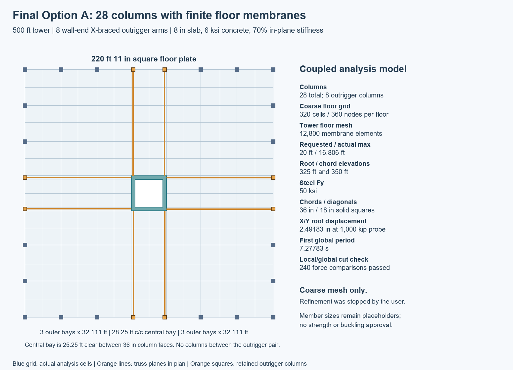

# 500 ft point tower — coupled core, outriggers and floor membranes

The current model is **Option A: 28 perimeter columns**, including eight outrigger
columns aligned with the core walls. It combines a concrete core spine, steel
X-braced outriggers and finite-stiffness floor membranes in one OpenSeesPy model.
The recorded results are from the **coarse mesh only**. The finer run was stopped
at the user's request; mesh convergence has not been established.

Run commands from this project artifact directory, which contains the root JSON
inputs and `tower_model/` source folder. This is a conceptual elastic model and
reproducible demand study, not a completed structural design.

## Current inputs

| Item | Value |
| --- | --- |
| Tower / stories | 500 ft / 40 stories at 12.5 ft |
| Floor plate | 220 ft 11 in square |
| Core outside dimensions | 31.25 ft square, H/B = 16 |
| Core walls / concrete | 36 in / f'c = 8 ksi |
| Column layout | 28 total; eight wall-aligned outrigger columns; no face-center columns between each outrigger pair |
| Outer bays | Three equal 32.1111 ft bays on each side of an outrigger pair |
| Central bay | 28.25 ft **center-to-center**; 25.25 ft physical clear width between 36-in columns |
| Outriggers | Eight arms in four planes, from Level 26 to Level 28 (325–350 ft) |
| Steel / sections | Fy = 50 ksi; 36-in solid-square columns and chords; 18-in solid-square diagonals |
| X intersections | Shared central joints, laterally restrained by the floor membrane |
| Floor slab | 8 in; f'c = 6 ksi; density 150 pcf; 70% gross in-plane stiffness |
| Floor behavior | Membrane action only; no slab bending or vertical gravity load transfer |
| Floor loading | D = 150 psf including slab; L = 50 psf; mass based on D + 0.25L |
| Lateral loading | Illustrative 1,000 kip triangular-height probe, distributed in plan by tributary area |

The steel section dimensions remain **placeholders**. Fy is a reference material
strength; elastic elements do not yield at that value. Stress output is not a
member capacity or buckling check.

## Run the final analysis

The recorded environment was Windows, CPython 3.12.13 and OpenSeesPy 3.8.0.0.
Create an environment with a Python version supported by the OpenSeesPy binary
for your platform. The recorded Windows pins are in
`tower_model/requirements-validated.txt`.

```powershell
python -m venv .venv
.\.venv\Scripts\python.exe -m pip install -r tower_model/requirements-validated.txt
.\.venv\Scripts\python.exe tower_model/membrane_patch_check.py
.\.venv\Scripts\python.exe tower_model/tower_membrane.py --spacing 20 --inputs tower_floor_mesh_option_a_inputs.json
```

The final entry point is **`tower_model/tower_membrane.py`**. It imports reusable
functions from `tower_model/tower.py` and `tower_model/local_truss.py`. Their
standalone mains are historical and are not configured for the packaged final
inputs. This folder contains only the current final inputs and results, not
the superseded model packages.

The driver solves X and Y separately, reuses the identical model's modal periods
for the second axis, writes results, and performs 40 local-cut checks. Negative
lateral signs are obtained by linear superposition with the gravity solution.
No finer-mesh run is required for reproducing the recorded results.

## Recorded coarse-mesh results

The requested maximum spacing is 20 ft. Alignment with walls, columns and truss
joints produces an actual maximum grid interval of **16.8056 ft**. Each floor has
360 membrane nodes and 320 elements: **14,400 membrane nodes and 12,800 elements**
over the tower.

| Quantity | Recorded value |
| --- | ---: |
| Roof lateral displacement, X or Y | 2.491833 in |
| Maximum story drift ratio | 0.000559592 |
| First global period | 7.277829 s |
| Peak top-chord absolute axial stress | 1.55998 ksi |
| Peak bottom-chord absolute axial stress | 1.66498 ksi |
| Peak diagonal absolute axial stress | 10.43069 ksi |
| Total D + L gravity weight | 480,919.341 kip |

These values apply only to the documented gravity and lateral probe, not to a
site-specific design hazard or factored load envelope.

Results are in `tower_model/results_membrane/option_a/mesh_20ft/`:

- `summary.json`: inputs, model statistics, periods, response, member envelopes and checks.
- `outriggers_X.csv`, `outriggers_Y.csv`: floor displacements and drift ratios.
- `outriggers_X_reactions.csv`, `outriggers_Y_reactions.csv`: base reactions.
- `member_envelopes.csv`: signed tension/compression envelopes by member.
- `local_global_cut_comparison.csv`: all 240 member-force comparisons.

## Local/global reconciliation

The floor meshes and trusses now solve together. Rigid constraints remain only
within each core wall footprint to represent the condensed core cross-section;
there is no floor-wide rigid-diaphragm constraint.

For verification, each truss arm is cut from the **same coupled model**. All
interface translations at its wall and column joints are prescribed from that
global solution, with matching member self-weight. Forty local solves cover
eight arms and five gravity/lateral-sign cases. Their 240 member-force
comparisons agree within a maximum absolute difference of **1.21 × 10^-11 kip**.
Compatibility, force/moment equilibrium, strain energy/work, X/Y symmetry and an
independent total-weight calculation also passed.

This is a consistency check of the shared model. It supersedes the earlier
one-way approximation that freed local column horizontal motions while the
global model retained rigid diaphragms. Exact cut-force agreement does not
validate the assumed material properties, loads or structural adequacy.

## Rhino and documentation

The primary Rhino deliverable is **`tower_500ft_option_a_membrane.3dm`**, in feet
and Rhino 7-compatible format. It contains 1,328 valid closed structural Breps
and 40 floor meshes reproducing the **12,800 analytical cells**. These meshes
represent floor mid-surfaces; they are not 8-in-thick slab solids. The layer
**`10 Coarse analytical floor mesh - toggle visibility`** is initially hidden
so the structural system stays legible. Enable it in the Layers panel to
inspect the actual analysis grid, and use Zoom Extents after opening.

Regenerate that file after the coarse analysis results exist:

```powershell
.\.venv\Scripts\python.exe -m pip install -r tower_model/requirements-rhino.txt
.\.venv\Scripts\python.exe tower_model/export_membrane_rhino.py
```

`tower_500ft_option_a.3dm` is the optional base structural export. It has generic
zero-thickness floor ring surfaces, which are **not the analytical grid**. Use
the `_membrane.3dm` deliverable for the complete final geometry and floor mesh.

See [MODELING.md](MODELING.md) for idealizations and limitations,
[INPUT_FORMATS.md](INPUT_FORMATS.md) for the three compatible input files, and
[HISTORY.md](HISTORY.md) for superseded revisions.



## Blender visualization

[Editable Blender scenes and presentation sheets](visualization/README.md) show the approved scheme in a translucent structural style and an architectural studio style, plus an isolated outrigger detail. The scene uses the same input geometry; colours and floor transparency are display treatments.
