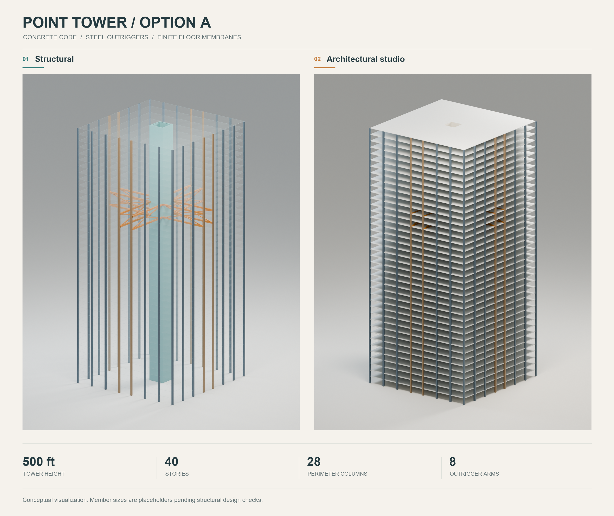
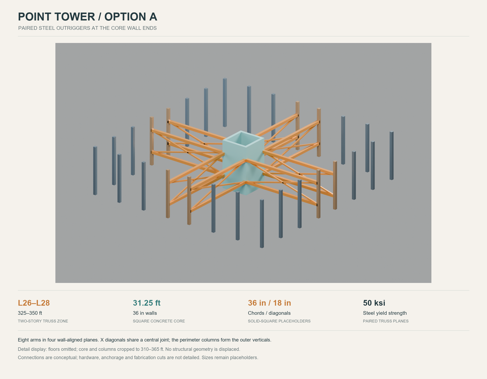

# Blender visualization — Point Tower / Option A

[Open the editable Blender model](point_tower_option_a.blend). The file was
created with **Blender 5.2.2 LTS** and contains three scenes: a structural
overview, an architectural studio view and an isolated outrigger detail.

## Presentation images

- [Two-style presentation board](presentation_board.png): structural and
  architectural studio views, with matching geometry.
- [Annotated outrigger detail](detail_board.png): paired steel trusses at
  Levels 26–28, 325–350 ft.
- Full-resolution renders: [structural](structural_hero.png),
  [studio](studio_hero.png) and [detail](outrigger_detail.png).



## Geometry and display choices

The visualization follows the final 500 ft, 40-story, 28-column Option A
inputs. Source JSON is embedded in the Blender file as Text datablocks for
reference. Scene geometry uses meters without changing the tower proportions:
152.4 m tower height, 67.3354 m square floor plate, 9.525 m square core outside
dimension and 0.9144 m core walls.

Verified structural counts are **28 columns**, including **eight outrigger
columns**, **16 chords** and **32 diagonal segments** forming eight X-braced
arms in four wall-aligned planes. Chords are 36 in solid squares; diagonals
are 18 in solid squares; steel Fy is 50 ksi. The hollow core and physical
wall-end attachment locations are retained.

The full-height scenes use true **8 in / 0.2032 m** floor thickness, centered
on the analysis floor elevations. These slabs are visualization geometry;
the OpenSees floor model remains an in-plane membrane model without slab
bending. Colors identify structural roles. Ghosted floors, edge bevels,
lighting and materials are display choices, not additional design assumptions.

The detail scene omits floor plates and crops the core and columns to
**310–365 ft** to expose the trusses. Members are not moved or exploded.
There is no added facade, gusset, anchorage, bolt or weld detailing. Sections
remain placeholders pending structural design checks.

## Rebuild and render

From the parent model artifact directory (`models/500ft-option-a`), with
Blender available on PATH:

```powershell
blender --background --factory-startup --python visualization/build_blender_visualization.py
python -m pip install Pillow==13.0.0
python visualization/compose_blender_boards.py
```

The Blender build uses **OptiX GPU rendering when available**, with a CPU
fallback. The board composer requires the three completed render PNGs and
preserves their aspect ratios; source renders are not overwritten.

See [scene metadata](scene_metadata.json) and the
[Blender validation report](blender_validation.json) for recorded geometry
checks. These checks and images do not establish structural adequacy.


